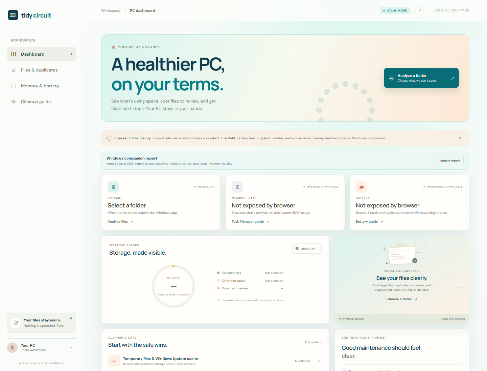
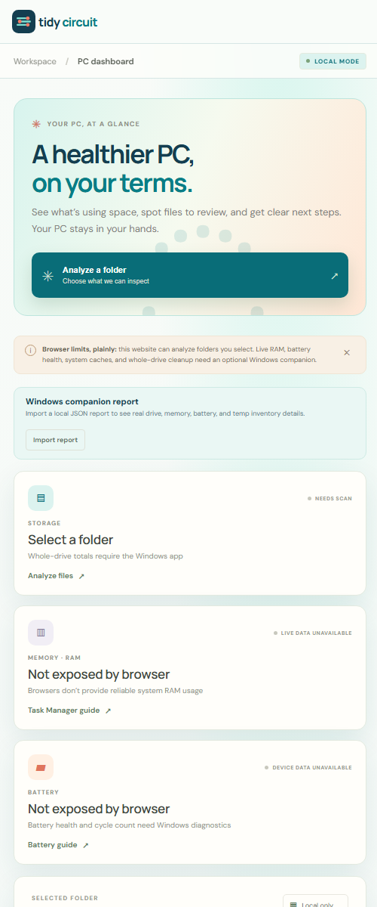

# TidyCircuit

**A clearer view of your PC. A calmer way to clean.** TidyCircuit is a free, open-source PC care project with a coastal, sea-glass look. It helps you inspect files, understand your Windows system, and make deliberate cleanup decisions.

Mobile dashboard

## Use it now

Open `index.html` in Edge or Chrome, or visit the [live demo](https://wlplease.github.io/CleanMeScarlett/) once deployed. Choose **Analyze a folder**. File names and contents stay in your browser; the site does not upload them.

| Feature | Today |
| --- | --- |
| Folder review | Search, filter by extension or folder, sort by size, name, or age; see paths and dates. |
| Duplicate verification | SHA-256 compares same-size files locally. Files over 256 MB or unreadable files are skipped and labeled. No automatic deletion. |
| Review list | Mark files, see the total, and export a TSV for manual follow-up. |
| Organization ideas | Extension groups for the selected folder; no automatic moves. |
| Windows companion | Export actual drive, RAM, battery charge, and current-user TEMP inventory to a JSON report. |
| Recoverable cleanup | Explicitly move one eligible old user TEMP file to local quarantine, log it, and restore by operation ID. |

The browser cannot see whole-drive usage, live RAM, battery health, or system caches on its own. Its file picker requires you to select a folder. For Windows data and scoped cleanup, see the [companion guide](companion/README.md). The companion is source code, not a signed public installer.

## Safety and privacy

- No account, telemetry, file upload, background scan, or automatic deletion.
- A matching hash verifies identical file contents for files that were successfully checked; it does not mean either copy is safe to remove.
- The companion only inventories current-user TEMP files older than the selected age. Quarantine requires an exact path and confirmation. Restore is available while the quarantined file remains.
- Windows Storage Sense handles OS temporary files and update cleanup. TidyCircuit links to [Microsoft's Storage Sense guidance](https://learn.microsoft.com/windows/configuration/storage/storage-sense) instead of editing system cache folders directly.

## Project files

- [Brand guide](BRAND.md) — color palette, logo, and voice
- [Windows companion](companion/README.md) — report, plan, quarantine, restore
- [Contributing](CONTRIBUTING.md) · [Security](SECURITY.md) · [MIT license](LICENSE)

## Hosting and name

This is a static front end suitable for a static host. Vercel Hobby has [personal, non-commercial terms](https://vercel.com/docs/plans/hobby); review the terms for your use.

**TidyCircuit remains a working name.** A basic web search found no obvious exact-name software match, but that is not US trademark clearance or proof a domain is available. Follow the [USPTO clearance guidance](https://www.uspto.gov/trademarks/search/comprehensive-clearance-search-similar-trademarks), including similar marks and existing commercial use, before registering the name or committing to a public product launch.

